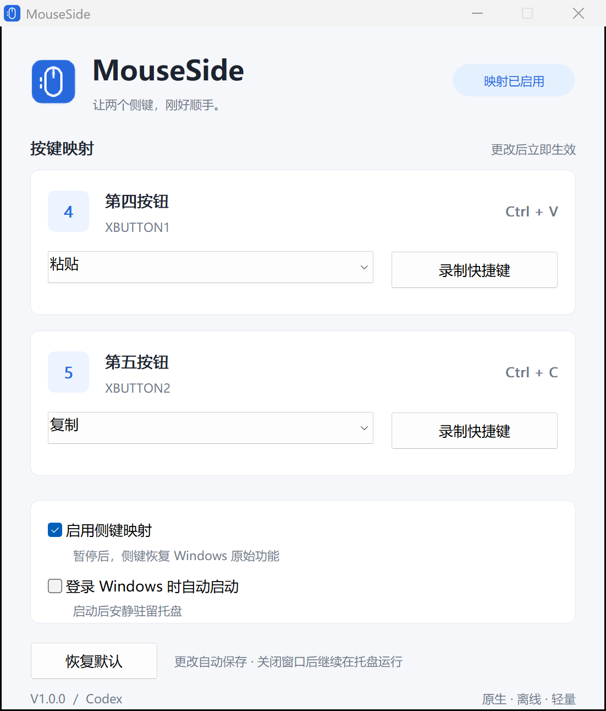

# MouseSide Codex 验证记录

日期：2026-10-14。目标：Windows 11 x64，C++20 原生桌面工具。

## 构建与独立性

- `codex` 是 orphan 分支，独立根提交 `d669a0d`，没有从既有开发分支继承源文件。
- 没有读取或拷贝既有模型实现代码；图标使用新绘制的鼠标图形。
- 本机无 MSVC，使用 WSL Debian / MinGW-w64 GCC 14 / CMake 构建 x64 Release，并直接在 Windows 上运行 EXE 和测试。
- 提供 MSVC 静态 CRT CMake 配置和本地构建脚本。MSVC 实编尚未验证。
- PE 导入仅为 Windows 系统 DLL：ADVAPI32、COMCTL32、dwmapi、GDI32、KERNEL32、msvcrt、ole32、SHELL32、USER32、UxTheme。没有 MinGW、Python、Node、WebView 或额外 VC 运行库安装依赖。

## 已执行测试

`./scripts/test.ps1 -BuildDirectory ./build-codex`：三组测试全部通过。

| 测试组 | 验证内容 |
| --- | --- |
| core_tests | 第四键 Ctrl+V / 第五键 Ctrl+C 默认值；合法组合键；无效修饰键和安全组合拒绝；严格配置解析；损坏字段恢复；INI 保存往返；保存失败；按下重复去重；成对吞掉松开；暂停中途切换；消息投递失败时放行；Win+D / Alt+Tab 录制状态；Esc / 失焦取消与释放；无效录制拒绝 |
| input_tests | 平衡的键盘按下/松开序列；已有左右修饰键和目标按键恢复；按住目标键不额外输入字符；按住 Alt 的映射及实际松开都不触发菜单；Win 掩蔽序列；真实 SendInput 到隔离测试窗口；真实 WH_MOUSE_LL 接收测试侧键并映射；原始事件成对拦截；暂停后把事件传递给下游隔离钩子 |
| gui_tests | --background 隐藏启动；带 SW_HIDE 启动标志的实例可被再次启动唤醒；重复启动进程退出并唤醒已有设置；从控件选择预设立即落盘；关闭隐藏并继续运行；托盘退出命令销毁窗口及进程 |

输入测试会临时激活自己的接收窗口，使用标记输入和独立接收钩子隔离其他映射工具；GUI 测试备份并恢复现有配置，不修改自启注册表。

实际原生窗口已在本机 DPI 下截图检查：字体、两张配置卡片、下拉控件、录制按钮、设置复选框和底部说明完整可见。

## 审查与回归修复

独立审查提出两项重要输入问题：临时释放 Alt/Win 可能激活菜单；恢复已经按住的主键可能额外输入字符。已修正输入序列，增加正常 DefWindowProc 菜单行为和实际字符接收测试；测试分别经历失败再通过。

同时将「主键已捕获、修饰键未松开时 Esc 仍必须取消」作为必要交互修复，通过状态机回归测试。实际测试中发现 SW_HIDE 启动标志会吞掉第一次显示请求，也补上失败测试并修复。

修复后完整三组测试通过，打包 EXE 再次通过 GUI 生命周期测试。硬件、MSVC 和长期资源项目没有被审查结论代替。

## 资源实测

2026-10-14，本机 16 个逻辑处理器；具体数值会随系统字体缓存、DPI 和使用过程变化。

| 项目 | 本次实测 |
| --- | --- |
| Release EXE | 904,192 字节，约 883.0 KiB |
| 首次后台启动后工作集 | 12.25 MiB |
| 首次后台启动后私有提交 | 2.02 MiB |
| 打开、关闭设置后的工作集 | 17.09 MiB |
| 打开、关闭设置后的私有提交 | 2.45 MiB |
| 关闭设置后 5 秒 CPU 时间增量 | 0.000 秒 |
| 进程 | 单进程；应用使用 GUI 与钩子消息线程，无轮询定时器 |

工作集没有达到 PRD 的「尽量 10 MB 以内」优化目标；这里只报告实测，不承诺绝对上限。没有为了压低数字强制清空工作集。长时间驻留的内存趋势和硬件延迟还需要实际使用测量。

## 仍需人工验收

- 小米无线鼠标 3 蓝牙、2.4GHz、连接模式切换、断开重连。
- 实际睡眠、唤醒和 Explorer 重启后的系统行为。
- 物理键盘录制 Ctrl+Shift+S、Alt+Tab、Win+D，确认不会触发系统操作；录制状态机已自动测试，真实物理录制钩子仍需操作验收。
- 浏览器、记事本、资源管理器及代码编辑器中实际复制、粘贴和快速连续侧键点击。
- 开机自启开/关后实际注销登录；实现为 HKCU Run，本次未修改用户登录设置。
- 高权限目标下 Windows UIPI 限制及注入失败提示。
- 跨屏不同 DPI、长时间后台资源趋势。

开始实际验收前，退出 XMBC 和其他模型版本的 MouseSide。测试过程发现已有 `V:\MouseSide.exe` 在运行；本次没有停止或修改该程序。
